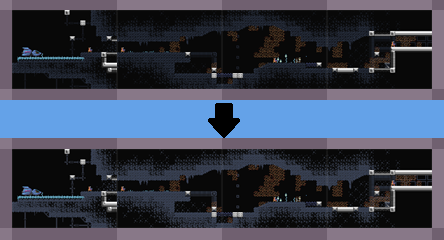

## Other miscellaneous functionality

The "More..." button in the upper right of the app window opens a window with links to miscellaneous functionality.

-----

There's a button to open the GitHub web page in a browser.

-----

The "Modify Dark Color Contrast" button opens a tool window that allows you to change how much dark colors are boosted.

Certain games use some dark colors that can make foreground and background hard to distinguish on a zoomed-out screenshot
map.  SnapMap lets you configure a boost to darker colors to make them brighter and more vibrant.  Here's an example from
the game Environmental Station Alpha, showing how normal screenshots make the dark caverns walls hard to discern, but the
dark-color-boosted screenshots make the terrain easier to see:

(Note that using this setting just changes how SnapMap _displays_ screenshots in the map grid.  Just as with 
the [MAP Trim](setup.md) feature, the screenshots saved to the `screenshots` folder on disk are pristine full screenshots
of the game, just as it appeared on your screen.)